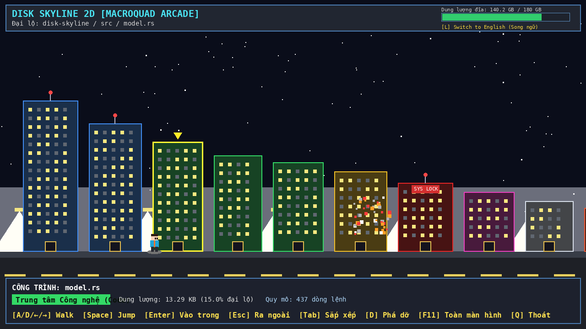
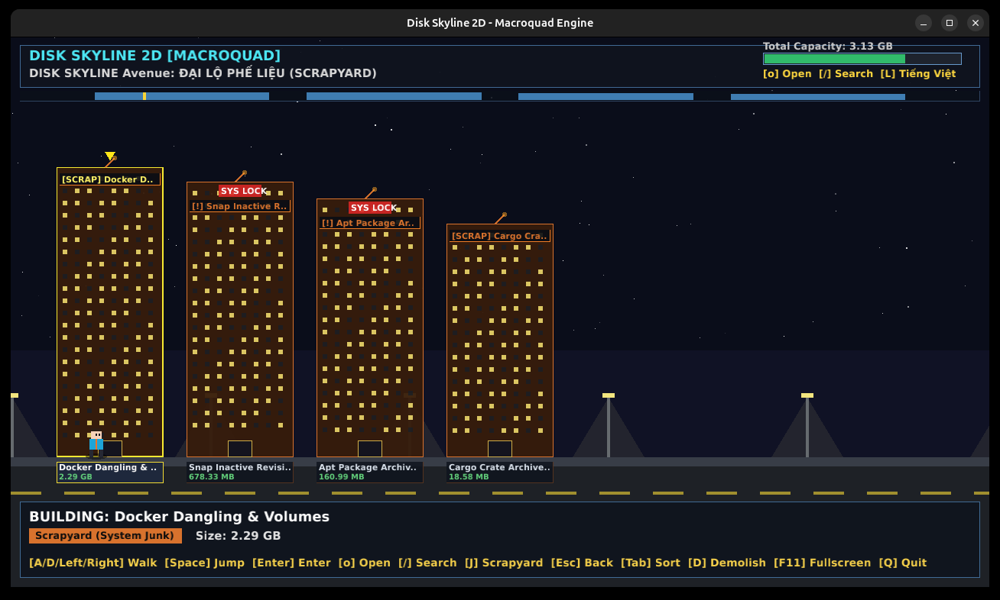

# 🏙️ DISK SKYLINE

[](https://github.com/Duycld03/disk-skyline/actions/workflows/ci.yml)
[](https://github.com/Duycld03/disk-skyline/actions/workflows/release.yml)
[](https://opensource.org/licenses/MIT)
[](https://www.rust-lang.org)

**Transform your filesystem storage into an interactive, cyberpunk-inspired 2D urban skyline right inside your terminal or as a native 2D desktop game window.**

Featuring **dual binary targets**:
1. 🖥️ **`disk-skyline`**: Blazing-fast terminal TUI powered by [Ratatui](https://ratatui.rs) and [Crossterm](https://github.com/crossterm-rs/crossterm).
2. 🎮 **`disk-skyline-gui`**: Standalone 60 FPS 2D desktop arcade game window powered by [Macroquad](https://macroquad.rs), featuring a walking pixel avatar, jumping physics, smooth camera tracking, retro RPG HUD, and explosion particle effects!

<p align="center">
  
</p>

```text
================================================================================
 DISK SKYLINE - Urban Planning Initialized
================================================================================
 DISK SKYLINE   Avenue: src
Zoning:  [Size (High -> Low)]  10 buildings (Total: 88.70 KB)
────────────────────────────────────────────────────────────────────────────────
|[*] [*] | |<> <> | |<> <> <> | |<> <> <| |<> <> <> <>| |<> <> | |<> <> <> <|
|[*] [*] | |<> <> | |<> <> <> | |<> <> <| |<> <> <> <>| |<> <> | |<> <> <> <|
|[*] [*] | |<> <> | |<> <> <> | |<> <> <| |<> <> <> <>| |<> <> | |<> <> <> <|
|[*] [*] | |<> <> | |<> <> <> | |<> <> <| |<> <> <> <>| |<> <> | |<> <> <> <|
|[ENTER] | | [#]  | |   [#]   | |  [#]  | |    [#]    | | [#]  | |   [#]    |
================================================================================
 model.rs   app.rs   render.rs   i18n.rs   demolish.rs   ui.rs    scanner.rs
 13.29 KB  12.93 KB  12.41 KB   12.31 KB    10.33 KB    9.94 KB    8.86 KB
▲ [SELECT]
St: [*##########################################################================
────────────────────────────────────────────────────────────────────────────────
BUILDING: model.rs | Tech Center (Code) | Size: 13.29 KB (15.0% avenue)
Path: /home/user/workspace/disk-skyline/src/model.rs | Scale: 1 stories (items)
[←/→/h/l] Stroll  [Enter] Enter  [Esc/Backspace] Back  [Tab] Sort  [d/Del] Demolish  [r] Rescan  [L] Lang (EN/VI)  [q] Quit
```

---

## ✨ Features

- 🏙️ **Logarithmic 2D Skyline**: Building heights scale logarithmically, guaranteeing that tiny files (e.g. 10 KB) remain visible beside massive multi-gigabyte structures without overflowing the screen.
- 🎨 **Thematic Architecture & Zoning**: Visual facades adapt according to file types:
  - 🏢 **Offices** (Directories)
  - 💻 **Tech Centers** (Source code: `.rs`, `.py`, `.js`, `.c`, `.go`...)
  - 🎬 **Entertainment Complexes** (Media: `.mp4`, `.mp3`, `.png`, `.jpg`...)
  - 📦 **Storage Vaults** (Archives: `.zip`, `.tar`, `.gz`, `.7z`...)
  - 🏭 **Industrial Plants** (Binaries & Executables)
  - 📚 **Publishing Houses** (Documents: `.md`, `.txt`, `.pdf`...)
  - 🪖 **Restricted Underground Bunkers** (Hidden dotfiles: `.git`, `.env`...)
- 🚶 **Interactive Street Stroll**:
  - Horizontal panning along avenues with smooth camera auto-centering.
  - Drill down into directories (`Enter`) and pop back out (`Esc` / `Backspace`).
  - Active real-time street minimap (`*` cursor and `#` viewport camera).
- 🔍 **Spotlight Search Engine (`/`)**:
  - Instant fuzzy search across building names in the active avenue.
  - Automatically warps camera and avatar focus directly to matched files in real time.
- 📂 **External Default Opener (`o`)**:
  - Non-blocking host OS launching for files and folders (`xdg-open` on Linux, `open` on macOS, `cmd /c start` on Windows).
  - Inspect code in VS Code, images in default viewers, or open directories without leaving Disk Skyline.
- ⏳ **File Staleness & Age Indicator**:
  - Files older than 180 days are recognized as stale: windows dim to an abandoned hue, and buildings display clear `[OLD]` / `[CŨ]` badges.
- 🌐 **Native Bilingual Support (i18n)**:
  - Supports **Vietnamese (Tiếng Việt)** and **English**.
  - Auto-detects OS locale (`LANG`/`LC_ALL`).
  - Set default via `--lang <vi|en>`.
  - **Toggle dynamically mid-session** anytime by pressing `L`!
- 🛡️ **System Protection Guard**:
  - Automatically bypasses virtual pseudo-filesystems (`/proc`, `/sys`, `/dev`, `/run`).
  - Hardened against accidental deletion: core OS paths (`/bin`, `/etc`, `/usr`, `C:\Windows`) are locked against demolition.
- 💣 **Safe Two-Tier Demolition Modal**:
  - Safely delete items directly from within the TUI.
  - Reclaims disk space and prunes in-memory trees without requiring a slow full rescan.
  - Two-tier safety confirmation: requires typing `YES` for files $\ge$ 1 GB or restricted bunkers.
- 🚜 **System Scrapyard Avenue & Bulldozer Cleaner (`J` / `C` / `--scrapyard`)**:
  - Fast non-blocking probes detect developer bloat and reclaimable junk: Docker dangling images/stopped containers/volumes (`docker system df`), disabled Snap revisions (`snap list --all`), global package caches (`npm`, `pip`, `uv`, `cargo`), and package archives (`/var/cache/apt/archives`).
  - Visualizes reclaimable space as an industrial **"Scrapyard Avenue" (Đại Lộ Phế Liệu)** with amber rust skyline towers and `[SCRAP]` neon signboards.
  - Target individual junk towers with `d` to execute platform-native purges, or trigger the **Bulldozer batch cleaner (`C`)** to sweep the avenue and reclaim gigabytes!

<p align="center">
  
</p>

### 🎮 2D Desktop Game Window (`disk-skyline-gui`)
Looking for a full gaming experience? Run `disk-skyline-gui` (or double-click `disk-skyline-gui.exe` on Windows):
- 🏃 **Pixel Avatar**: Stroll along the avenue (`A`/`D`/Arrow keys), jump on `Space`, and face buildings in real-time.
- 🗺️ **Street Radar Minimap**: Sleek 14px radar bar under the HUD rendering the entire avenue's height profile with real-time avatar tracking.
- 🔍 **Interactive Spotlight Overlay**: Press `/` to bring up a glowing cyber search bar and jump between buildings.
- 🏷️ **Neon Facade Signboards & Nameplates**: Crisp building identification with category badges (`[DIR]`, `[CODE]`, `[MEDIA]`, `[OLD]`).
- 🌌 **Starfield & Horizon**: Parallax twinkling stars, city streetlights, illuminated window grids, and illuminated rooftops.
- ⚔️ **RPG Status HUD**: Disk storage rendered as an arcade Mana/HP capacity bar.
- 💥 **Particle Explosions**: Watch files crumble into pixel debris when demolished!
- 🪟 **Desktop Ready**: Configurable `1280x720` resolution with instant fullscreen toggle (`F11`).
---

## 🚀 Installation

### 1. From Precompiled Binaries (GitHub Releases)
Download the latest precompiled release for your platform from [Releases](https://github.com/Duycld03/disk-skyline/releases):
- **Linux** (`x86_64-unknown-linux-gnu`, `x86_64-unknown-linux-musl`)
- **Windows** (`x86_64-pc-windows-msvc.zip`)
- **macOS** (`x86_64-apple-darwin` for Intel, `aarch64-apple-darwin` for Apple Silicon M1/M2/M3)

### 2. Using Cargo
```bash
cargo install --git https://github.com/Duycld03/disk-skyline
```

### 3. Build from Source
```bash
git clone https://github.com/Duycld03/disk-skyline.git
cd disk-skyline
cargo build --release
# Run terminal CLI:
./target/release/disk-skyline
# Or launch 2D Game window:
./target/release/disk-skyline-gui

---

## ⌨️ Controls & Keybindings

| Key | Action | Mô tả (Tiếng Việt) |
| :--- | :--- | :--- |
| `←` / `→` / `h` / `l` | Stroll along the street | Dạo phố / Di chuyển camera |
| `Enter` | Enter building / Drill down | Đi vào trong tòa nhà / thư mục con |
| `Esc` / `Backspace` / `u` | Exit to parent street | Đi ra ngoài / quay lại thư mục cha |
| `Tab` | Cycle zoning / sort mode | Đảo chế độ sắp xếp (Dung lượng, Tên, Phân loại) |
| `d` / `Delete` | Demolish building | Phá dỡ / Giải phóng công trình |
| `r` / `F5` | On-demand rescan | Quét và đồng bộ lại thư mục hiện tại |
| `o` / `O` | Open in default host app | Mở tệp/thư mục bằng ứng dụng mặc định của hệ điều hành |
| `/` | Spotlight search | Tìm kiếm nhanh công trình trong phố |
| `J` | **Toggle Scrapyard Avenue** | **Chuyển sang Đại Lộ Phế Liệu (Junk Cleaner)** |
| `C` | **Bulldozer Clean All (in Scrapyard)** | **Xe ủi dọn sạch bãi phế liệu** |
| `L` | **Toggle Language (EN $\leftrightarrow$ VI)** | **Đổi ngôn ngữ Tiếng Việt $\leftrightarrow$ English** |
| `q` / `Ctrl+C` | Exit application | Thoát chương trình |

---

## 🛠️ CLI Arguments

```text
Usage: disk-skyline [OPTIONS] [PATH]

Arguments:
  [PATH]  Target directory to survey (defaults to current directory '.') [default: .]

Options:
  -d, --depth <DEPTH>  Maximum initial recursive scan depth [default: 6]
      --snapshot       Print a single non-interactive skyline snapshot and exit
  -s, --scrapyard      Launch directly into the System Scrapyard survey (Đại Lộ Phế Liệu)
  -l, --lang <LANG>    Interface language / Ngôn ngữ hiển thị [possible values: vi, en]
  -V, --version        Print version
```

### Examples:
```bash
# Explore current directory
disk-skyline

# Explore specific directory with English interface
disk-skyline /var/log --lang en

# Scan deep directory structure
disk-skyline ~/projects -d 8

# Output single-frame ASCII skyline to terminal (e.g. for scripts or READMEs)
disk-skyline --snapshot
```

---

## 📄 License

Distributed under the [MIT License](LICENSE).
Copyright (c) 2026 Duycld03.
